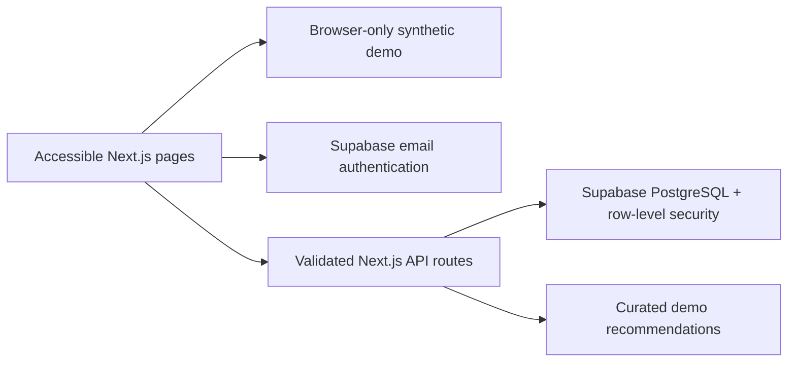

# CarePlate

A senior-friendly diabetes wellness companion built with Next.js App Router, TypeScript, Tailwind CSS, Lucide icons, Zod, and Supabase. This MVP is a wellness prototype, **not a medical device**. All included people, readings, meals, and notes are synthetic.

## Architecture and data model



- `auth.users` supplies authenticated identities; `profiles` holds the display name and role label.
- `caregiver_permissions` records invitation email, senior, accepting caregiver, write scope, acceptance, and revocation. Consent, rather than a client-controlled role, governs access.
- `glucose_readings` stores the original units, context, optional meal association, timestamp, and notes. `blood_pressure_readings` stores systolic, diastolic, pulse, and context notes.
- `food_preferences` keeps versioned allergy, taste, dietary, kitchen, budget, and optional clinician-guidance preferences.
- `recipes` contains the catalog identities. The complete synthetic recipe catalog and estimated nutrients are in `lib/demo.ts`.
- `meal_plans`, `meal_logs`, and `meal_ratings` distinguish intended meals, actual portions eaten, and subjective feedback. Recipe serving quantities are per one serving.
- `shopping_lists` keeps versioned consolidated, editable item lists.
- `pattern_observations` reserves a relational store for reviewed evidence. Current observations are recomputed transparently on demand, never silently persisted as medical conclusions.
- `caregiver_notes`, `clinician_settings`, and `audit_log` support shared care. Measurements and notes are not copied into audit metadata.

Every private record has an owner. Entries have an authenticated `created_by` attribution. RLS requires accepted, unrevoked permission for caregiver reads/writes. The API uses the signed-in person's bearer token and public anon key, **never a service-role bypass**. Clinician settings cannot be written by application users.

## Run locally

Use Node 24 (tested on 24.19.0) and npm 11. From this checkout:

```sh
npm ci
npm run dev
```

Demo mode requires no credentials, databases, or AI providers. Demo changes persist in this browser's local storage; **do not enter real health information in demo mode**. Use Settings → Reset demo records to restore the synthetic records. The first visit opens the useful home dashboard; `/welcome` provides an introduction.

```sh
npm run typecheck
npm test
npm run build
npm run start
# With the app running on port 3000 and Chromium installed:
npm run test:browser
```

Browser tests default to `/usr/bin/chromium`; override `CHROMIUM_PATH` for another installation. Alternatively install Chromium with Playwright in your own environment. The database test uses embedded PostgreSQL (PGlite), mocks Supabase's `auth.uid()` and `auth.jwt()` helpers, applies the real migration, and checks actual RLS policies. It does not replace testing against your deployed Supabase project.

## Connect Supabase

1. Create a Supabase project in an appropriate region. Use a development project first.
2. Apply `supabase/migrations/001_careplate.sql` once in the SQL editor, or using your Supabase CLI migration workflow.
3. Copy `.env.example` to `.env.local` and set `NEXT_PUBLIC_SUPABASE_URL` and `NEXT_PUBLIC_SUPABASE_ANON_KEY` to the project's URL and public anon key. Never put a service-role key in public environment variables.
4. Enable email/password authentication, confirm email delivery and redirects, set your production site URL, and enforce suitable password/MFA policies in Supabase.
5. Restart/rebuild Next.js after changing public variables. In Settings, create an account, confirm the email if required, then sign in. A new account starts empty, with no synthetic health records copied into it.
6. Invite a caregiver by their account email in My care circle. They sign in with that verified email and explicitly accept the invitation. No email invitation is sent by CarePlate; tell your caregiver to open their care-circle page. Once accepted, they select “View senior’s records”. Revoke access from the senior account to stop further database access.
7. Test two real accounts and a third unauthorized account against your project before real use. RLS is mandatory. Keep email confirmation enabled to prevent email-based invitation impersonation.

Required hosted-service network access is your own `<project-ref>.supabase.co` hostname. Add that exact hostname in environment network settings; it is deliberately not guessed or broadly allowed here. The running cloud environment has no Supabase variables or credentials configured. Demo and automated database-policy tests run independently.

## Clinician targets and emergency plans

There are **no universal glucose targets or emergency thresholds** in this app. When no clinician settings exist, the app says so and provides a general reminder to follow the person's established care plan. A deployment administrator must verify a clinician's authority and enter individualized configuration into the protected `clinician_settings` table using a secure administrative workflow:

- `owner_id`: the senior's authenticated UUID.
- `glucose_low_mg`, `glucose_high_mg`: individual target bounds in mg/dL.
- `action_low_mg`, `action_high_mg`: optional clinician-supplied limits for displaying the written action plan; these are separate from target bounds.
- `action_plan`, `clinician_reference`, `verified_at`: the clinician-provided instructions and provenance.

Do not invent these values. App users and caregivers cannot write this table. A recorded glucose outside configured action limits displays a prominent message with the written plan and directs the person to appropriate medical help. CarePlate is **not actively monitored**, and does not provide emergency detection, medication decisions, blood-pressure interpretation, or an on-call service. A clinician portal and formal clinical governance remain deployment work.

## Implemented workflows

- Quick glucose entry with mg/dL/mmol/L conversion, contexts, meal links, and timestamps; blood pressure and pulse recording with notes.
- Day/week/month glucose charts with text summaries, pressure history, and print-friendly reports.
- Recipe details, ingredients, serving-scaled estimates, preparation steps, planning by date, meal logging and ratings.
- Allergy/dislike filtering and preparation-time matching; enjoyed, repeatable meals rank higher for taste only. Dietary guidance and budget preferences are retained for the care circle to review.
- Shopping lists for planned meals over 3/7 days, duplicate consolidation, quantity edits, pantry/checked status, printing and OS share/copy.
- Patterns require three distinct paired meals of the same name. Pre-readings are within 60 minutes before eating; post-readings 60–180 minutes later, preferring 120 minutes. An explicit meal link must match. Original units convert before comparison. Reusing one evidence pair or duplicate meal IDs does not create extra observations. Summaries report averages, measurement timing, and recorded confounders, not causation.
- Authenticated caregiver invitations, acceptance, revocation, on-behalf-of entry attribution, database audit events, shared notes and weekly counts.
- Text size and contrast settings; keyboard-operable forms, focus indicators, dialog focus trapping, large controls and responsive navigation.
- Account record export, owner-only record deletion, browser demo reset, and printable reports (browser print → Save as PDF).
- PWA manifest and installable shell on supported HTTPS browsers. No offline health-data caching: the service worker deliberately does not intercept requests. Offline sync is not implemented.

## Limits and deployment checklist

This is a functional MVP, not a clinically validated or production-certified health application. The nutrition values and recommendations are **clearly labeled illustrative demo calculations**, not a verified nutrition database or medical recommendation. The server-side `/api/recommendations` route validates a minimal allergy/taste/time request and returns the local catalog; it calls no external provider. Main pages use that same catalog locally so demo mode works without a service.

Allergy filtering matches catalog allergens and ingredient names, but does not infer every synonym, ingredient derivative, or manufacturing cross-contact. It is not an allergy guarantee. Complex clinician dietary guidance (including kidney restrictions), available-ingredient matching, budget-aware substitutions, nutritional optimization, and photo uploads require further implementation and dietitian review. The pattern feature describes repeated meal associations; it does not yet perform controlled ingredient/portion comparisons or medication modeling. Custom meals support a name, actual servings, and a user-entered estimated total carbohydrate amount. Full recipe creation remains future work.

Use browser print for PDF reports; no server PDF service is required. Account deletion erases application health records and the person's care grants; authentication identities and provider backups require a separate administrator-managed erasure/retention process. Read/export access and retention management need production audit procedures; current audit triggers cover record mutations and care-consent actions.

A real deployment needs HTTPS, reviewed Supabase storage encryption/backups, least-privilege administration, session refresh and shared-device policies, rate limiting, a content-security policy appropriate to the final deployment, monitoring without PHI, disaster recovery, accessibility testing with seniors, clinical governance, threat modeling, penetration testing, and jurisdiction-specific privacy/security/legal review. Authentication and encryption **do not establish HIPAA compliance**. Assess covered-entity/business-associate status, execute required BAAs (including hosting, database, logging, and any AI vendors), perform a documented risk analysis, implement workforce/access controls, breach response, retention/erasure procedures, and patient consent processes.

Before adding real AI or nutrition providers, validate nutrient/allergen provenance and licensing, keep secrets exclusively server-side, minimize data, and obtain explicit informed consent and appropriate contractual/privacy arrangements before transmitting any identifiable health information. This MVP sends none to an external AI provider.

## Cloud environment

The existing isolated checkout is `/workspace/Diabetes-POC`; do not create a Git worktree for routine tasks. Dependencies are captured in `package-lock.json`. Saved environment install/start instructions reproduce installation and describe process startup; running services must restart in a fresh task. Saving configuration does not publish the environment snapshot. This repository was initially unborn (no commits); generated project files remain available for review and commit.
